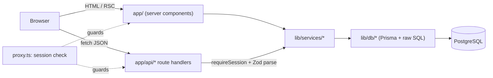

# ACME Salary Manager

ACME has 10,000 employees in 8 countries, and its HR Manager kept their salaries in
Excel. This app replaces the spreadsheet. The HR Manager can manage employees and
salaries, and every salary change is kept in an audit trail. They can also answer pay
questions such as _"what's the median salary for engineers in India?"_ or _"how does
a Software Engineer's pay compare across countries in USD?"_ in two clicks or fewer
from the Insights page (one filter, one tab).

The specs that drove the build live in [`context/`](context/). Start with the
one-page [project overview](context/project-overview.md).

## Features

- **Employee directory**
  - Server-side search across name, email and code, plus filters for country,
    department and job title. Sorting works on any column, including salary
    normalised to USD.
  - Numbered pagination with rows per page and "go to page".
  - Every view lives in the URL, so it can be linked and the back button works.
- **Add, edit and terminate employees**
  - Validation shows inline on each field. Salaries are entered in normal units
    and stored exactly in minor units.
  - The currency follows the country.
  - Termination is a soft delete behind a confirmation that asks for a reason.
    Terminated employees are read-only and can be reinstated.
  - The directory has an Active / Terminated / All status filter. The terminated
    view lists the most recent leavers first, with the date they left.
- **Activity trail** for each employee: every field change (job title, department,
  country and so on) with before and after values, plus terminations and
  reinstatements with their reasons, all attributed to the user who made them.
- **Salary history** for each employee: old and new values, % change, currency
  moves, the reason, and who made the change. History is written in the same
  database transaction as the change itself.
- **Insights**
  - Headcount, median, average and salary range.
  - Median salary by country, department or job title, with a full min, median,
    average and max table.
  - Headcount by country, and a salary distribution histogram.
  - All figures are in USD, at a versioned, static FX rate shown on the page.
- **CSV export** of exactly what is on screen: the directory (with its search,
  filters, status and sort, every page) and the insights "salary by…" table. Amounts
  are exact decimals, not formatted text, so they work in Excel formulas. The file
  is UTF-8 with a BOM so Excel shows names and currency symbols correctly, and cells
  that would run as spreadsheet formulas are neutralised.
- **Sign-in** for the single HR Manager account, with a signed session cookie.
  Every page and API is protected.

## Quick start

Requirements: Node.js 20.19 or later, and PostgreSQL 15 or later running locally
(Homebrew or Docker).

```bash
cp .env.example .env          # set the database URLs, SESSION_SECRET and SEED_ADMIN_*
createdb acme_salary
createdb acme_salary_test
npm install                   # also generates the Prisma client
npm run db:migrate            # apply migrations to the dev database
npm run db:seed               # 10,000 employees + the HR Manager login (~5 s, replaces all data)
npm run dev                   # http://localhost:3000
```

Sign in with `SEED_ADMIN_EMAIL` and `SEED_ADMIN_PASSWORD` from your `.env`.

`npm run db:seed` replaces all data. It refuses to run against a database that
holds changes made by HR users (salary changes or audit events), so it can't wipe
real work by mistake. Set `SEED_FORCE=true` to wipe it anyway.

| Script               | Purpose                                             |
| -------------------- | --------------------------------------------------- |
| `npm run dev`        | Start the dev server                                |
| `npm run build`      | Generate the Prisma client and build for production |
| `npm start`          | Serve the production build                          |
| `npm run test`       | Run unit, component and integration tests           |
| `npm run test:perf`  | Check the latency budgets against a 10k-row dataset |
| `npm run lint`       | ESLint, zero warnings allowed                       |
| `npm run typecheck`  | Generate route types and run `tsc`                  |
| `npm run format`     | Format with Prettier                                |
| `npm run db:migrate` | Create or apply migrations in development           |
| `npm run db:deploy`  | Apply migrations (CI / production)                  |
| `npm run db:seed`    | Replace all data with the deterministic seed        |
| `npm run db:reset`   | Drop, re-migrate and re-seed the dev database       |

## Tech stack

Next.js 16 (App Router, Cache Components) · TypeScript (strict) · PostgreSQL ·
Prisma 7 · Zod · Tailwind CSS v4 · shadcn/ui · Recharts · `jose` + bcrypt ·
Vitest + React Testing Library.

## Architecture



| Folder            | Responsibility                                                     |
| ----------------- | ------------------------------------------------------------------ |
| `app/`            | Pages (server components) and layouts                              |
| `app/api/`        | HTTP only: parse with Zod, check the session, call one service     |
| `lib/services/`   | Business logic and transactions; throws typed domain errors        |
| `lib/db/`         | Prisma client and parameterised raw SQL (directory, insights, FX)  |
| `lib/validation/` | Zod schemas shared by the API, the pages and the forms             |
| `lib/auth/`       | Session tokens, password hashing, `requireSession`                 |
| `components/`     | UI; `components/ui/` holds the shadcn primitives (not hand-edited) |
| `prisma/`         | Schema, migrations, deterministic seed                             |
| `tests/`          | Integration tests against a separate Postgres test database        |

The full picture, with the ERD and invariants, is in
[`context/architecture.md`](context/architecture.md).

### Key decisions

Each decision, with its alternatives and trade-offs, is recorded in the
[progress tracker](context/progress-tracker.md#architecture-decisions).

- **Money is stored as integer minor units plus an explicit currency** (AD-1).
  Salaries stay in the employee's country currency. USD figures are computed from a
  **static, versioned FX table**, and every result names the version it used (AD-2).
- **All aggregation runs in SQL** (AD-3). The median uses `percentile_cont`
  (AD-4). Nothing loops over 10,000 rows in JavaScript.
- **Every salary change writes a history row in the same transaction**, with a
  row lock so concurrent edits can't record a wrong "old" salary (Invariant 5,
  AD-18). A country move records both currencies (AD-17).
  Both properties are covered by tests, including a forced rollback and a
  concurrency test that fails without the lock.
- **Offset pagination with a total**, so the HR Manager can jump to any page
  (AD-5). Search uses `ILIKE`; `pg_trgm` is the upgrade path past about 1M rows
  (AD-6).
- **Postgres everywhere, including tests** (AD-12). Tests prove behaviour on the
  same engine production runs.
- **Two layers of auth** (AD-26). `proxy.ts` redirects or returns 401, and every
  route handler checks the session again.
- **URL-driven, server-rendered UI** (AD-29). Filters, sorting and paging are
  links, and only the controls are client components.
- **A deterministic seed** of 10,000 employees with consistent salary histories,
  in about 5 seconds (AD-8, AD-16).

## Testing

**310 tests across 33 files.** They are fast and deterministic, and make no network
calls.

| Project       | Tests | What it covers                                                                                                                                                       |
| ------------- | ----: | -------------------------------------------------------------------------------------------------------------------------------------------------------------------- |
| `unit`        |   159 | Pure logic: money parsing and formatting, validation, URLs, pagination, chart data, seed, sessions, proxy                                                            |
| `component`   |    48 | React Testing Library: login, directory toolbar and table, employee form, terminate dialog, history, pagination, charts                                              |
| `integration` |   103 | Services and route handlers against a real Postgres test database, including rollback, concurrency, the 401 sweep over every protected route, and performance at 10k |

- The integration tests run against `TEST_DATABASE_URL`, and refuse any database
  whose name doesn't end in `_test`.
- SQL aggregates are checked against hand-computed fixtures, and against an
  independent JavaScript calculation over generated data.
- Key tests were **mutation-checked**: removing the history write, the row lock
  or a session check makes them fail.

## Performance

Measured on 10,000+ seeded employees: real HTTP requests to `next start`, 20 warm
requests per URL, on a local machine.

| Request                                   | Median | Worst | Goal     |
| ----------------------------------------- | -----: | ----: | -------- |
| Directory API, sorted by USD salary       |  14 ms | 24 ms | < 300 ms |
| Directory API, search + filter + USD sort |  12 ms | 16 ms | < 300 ms |
| Directory API, page 200                   |  31 ms | 33 ms | < 300 ms |
| Insights API, summary                     |  20 ms | 22 ms | < 500 ms |
| Insights API, by job title                |  24 ms | 25 ms | < 500 ms |
| Insights API, distribution                |  30 ms | 31 ms | < 500 ms |
| `/employees` page (USD sort)              |  26 ms | 36 ms | —        |
| `/insights` page (by job title)           |  40 ms | 44 ms | —        |

`npm run test:perf` checks these budgets against the full 10,000-employee seed
(`tests/performance/`). It is kept out of `npm test` on purpose: timings depend on
the machine, and a test that fails on a slow CI runner is not deterministic.

## How this was built

The project follows a **spec-driven workflow**. Six context files define what to
build and how, and every unit of work is implemented against them:

| File                                                   | Defines                                                 |
| ------------------------------------------------------ | ------------------------------------------------------- |
| [`project-overview.md`](context/project-overview.md)   | Scope, goals, success criteria                          |
| [`architecture.md`](context/architecture.md)           | Boundaries, ERD, auth model, invariants                 |
| [`code-standards.md`](context/code-standards.md)       | Conventions, API rules, testing rules                   |
| [`ui-context.md`](context/ui-context.md)               | Design tokens, layout patterns, states, charts          |
| [`ai-workflow-rules.md`](context/ai-workflow-rules.md) | How work is scoped, verified and committed              |
| [`progress-tracker.md`](context/progress-tracker.md)   | Plan, decisions, open questions, and the AI prompts log |

Work was done with an AI coding assistant, one phase per commit, using
conventional commits. The
[AI prompts log](context/progress-tracker.md#ai-prompts-log) records each prompt,
how the output was reviewed, and what was corrected. Examples include a Zod 4
trim-order bug, Next 16 prerender errors found only on the live server, and a
build failure hidden by a shell pipeline.

## Known limitations

- **One user, one role.** RBAC, SSO and multi-tenancy are out of scope (see the
  project overview).
- **FX rates are static and versioned**, not live, by design. Updating them means
  adding a new version.
- **A missing employee's page returns HTTP 200 with the not-found UI and
  `noindex`**, because Next streams the page before the lookup finishes. The API
  returns a real 404 (AD-32).
- **No login rate limiting**, which suits a single internal user. In production it
  belongs at the platform edge.
- **Light theme only.**
