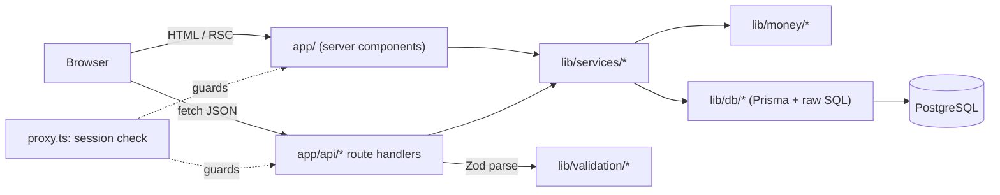
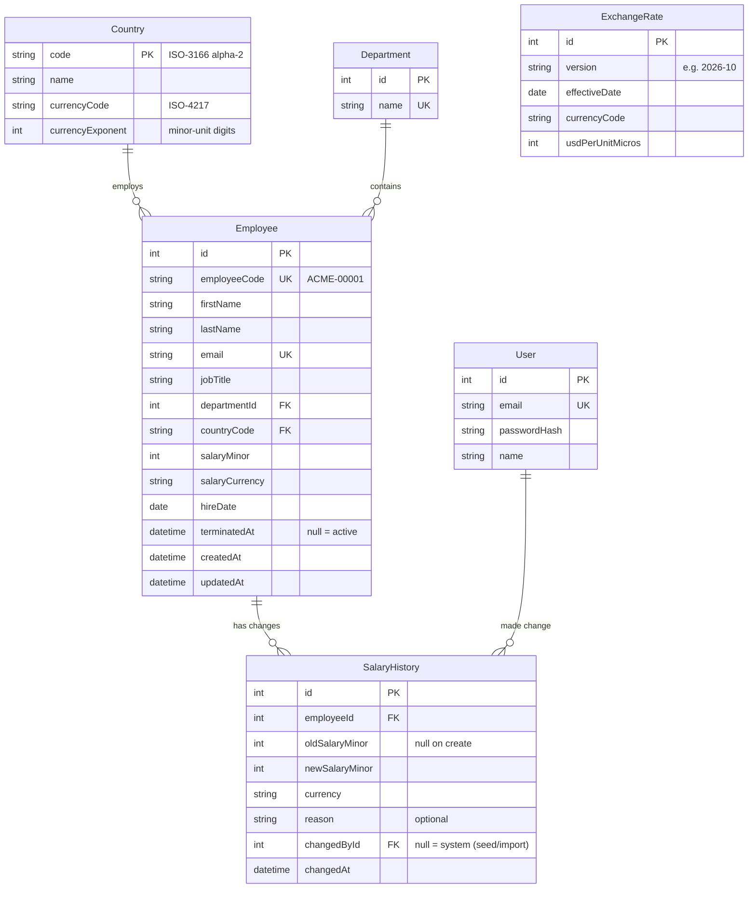

# Architecture Context

## Stack

| Layer      | Technology                                   | Role                                                                 |
| ---------- | -------------------------------------------- | -------------------------------------------------------------------- |
| Framework  | Next.js 16 (App Router, Cache Components) + TypeScript (strict) | Pages (server components) and HTTP API (route handlers) in one app |
| UI         | Tailwind CSS + shadcn/ui + Lucide icons      | Design tokens, accessible primitives, icons                          |
| Charts     | Recharts                                     | Insights bar charts and histogram                                     |
| Validation | Zod                                          | Parse every external input (request bodies, query strings, env)      |
| ORM        | Prisma 7 + `@prisma/adapter-pg`              | Schema, migrations, typed queries; `$queryRaw` for aggregations. The client is generated into `lib/db/generated/` (gitignored) |
| Database   | PostgreSQL 15+ everywhere (dev, test, prod)  | Relational storage for all data; separate `_test` database for tests |
| Auth       | bcryptjs + `jose` (signed JWT in HttpOnly cookie) | Single seeded HR Manager login, stateless session                 |
| Seed data  | `@faker-js/faker` with a fixed seed          | Deterministic 10,000-employee dataset                                 |
| Testing    | Vitest + React Testing Library               | Unit, service/integration (against test DB), component tests         |
| Hosting    | Vercel + Neon Postgres                       | Deployment target                                                     |

## System Boundaries

- `app/` — Pages, layouts, and route groups. These are server components by default.
  They read data by calling `lib/services/*` directly and never call their own API over
  HTTP from the server.
- `app/api/` — HTTP only. A handler parses the input with a `lib/validation` schema,
  checks the session, calls one service function, and maps the result or error to a
  response. It contains no business logic and no Prisma calls.
- `components/` — React components. `components/ui/` holds the shadcn primitives, which
  are protected. Feature components live in `components/<feature>/`.
- `lib/services/` — Business logic: employee CRUD, the directory query, insights,
  salary history, and auth. This is the only layer that defines transactions. It
  throws typed domain errors.
- `lib/db/` — The Prisma client singleton and raw-SQL query modules, such as the
  aggregation queries. This is the only place `PrismaClient` and `$queryRaw` are used.
- `lib/validation/` — Zod schemas and their inferred types. The API and the forms
  share these schemas.
- `lib/money/` — Pure helpers for minor-unit conversion, formatting, and FX
  conversion.
- `prisma/` — `schema.prisma`, migrations, and `seed.ts` (the CLI entry). Under
  `prisma/seed/`, `reference-data.ts` holds the static data, `generate.ts` is the
  pure, deterministic dataset builder, and `write.ts` does a truncate and bulk insert
  in one transaction, then resets the id sequences.
- `lib/db/create-client.ts` — builds a Prisma client for a connection string, without
  `server-only`. The seed and the tests use it. App code uses the `lib/db/client.ts`
  singleton.
- `tests/` — Test setup, DB helpers, and fixtures. Unit tests sit next to their source
  as `*.test.ts`. Integration tests live in `tests/integration/`.

## Storage Model

- **Relational database (only store)**: All state lives in the database: employees,
  reference data (countries, departments), FX rates, salary history, and the user.
  The app has no blob storage and no cache layer.
- **Money**: Salaries are stored as an integer in minor units (`salaryMinor`) next to
  an explicit ISO-4217 currency (`salaryCurrency`). The currency's exponent comes from
  `Country.currencyExponent`: 2 for USD and EUR, 0 for JPY. Values are annual gross
  base salary. Zod caps `salaryMinor` at 2,000,000,000 so it fits in a 32-bit Int on
  Postgres.
- **FX**: `ExchangeRate` rows are immutable and grouped by `version`. The active
  version is the one with the latest `effectiveDate`. A rate is stored as
  `usdPerUnitMicros`, meaning USD per one major unit × 1,000,000, so 1 GBP = 1.27 USD
  is stored as 1,270,000. All USD figures come from the active version, and responses
  include the `fxVersion` they used.

`ExchangeRate` is unique on `(version, currencyCode)` and has no FK to Country,
because several countries can share a currency (EUR).

Physical tables and columns are snake_case (`employees.salary_minor`, through Prisma
`@@map`/`@map`), so raw SQL needs no quoted identifiers. The Prisma models keep
camelCase. `SalaryHistory.changedById` is nullable, and null means a system change:
the seeded initial salaries and history predate any user. Every change made through
the app records the signed-in user. Every foreign key uses `ON DELETE RESTRICT`
(Invariant 10: rows are never hard-deleted).

**Indexes:** Employee has `(countryCode)`, `(departmentId)`, `(jobTitle)`,
`(lastName, firstName)`, `(hireDate)` and `(terminatedAt)`. SalaryHistory has
`(employeeId, changedAt)`. ExchangeRate has `(version, currencyCode)` UNIQUE and
`(effectiveDate)`.

## Auth and Access Model

- There is exactly one user, the HR Manager, created by the seed from the
  `SEED_ADMIN_EMAIL` and `SEED_ADMIN_PASSWORD` environment variables. The password is
  stored as a bcrypt hash. The app has no sign-up page.
- `POST /api/auth/login` checks the credentials and sets a signed JWT (HS256, secret
  `SESSION_SECRET`, 8-hour expiry) in an `HttpOnly`, `Secure`, `SameSite=Lax`
  cookie. `POST /api/auth/logout` clears the cookie.
- Next.js `proxy.ts` (Next 16's replacement for `middleware.ts`) verifies the cookie on every request except `/login`,
  `/api/auth/login` and static assets. Pages without a valid session redirect to
  `/login`. APIs return `401 { error }`.
- The signed-in user can do everything. The user's id is recorded as `changedById` on
  SalaryHistory.

## Invariants

1. Route handlers contain no business logic and no Prisma calls. They do Zod parse →
   auth → one service call → response mapping.
2. All aggregation (counts, min, max, avg, median, histogram buckets, USD conversion)
   runs in SQL. The app never loops over employees in JS to compute statistics.
3. Every list endpoint is paginated on the server, with a hard maximum page size of
   100.
4. Money is always an integer in minor units with an explicit currency. Floats are
   never stored.
5. Every create or change of `salaryMinor` writes a SalaryHistory row in the same
   database transaction. No code path updates salary outside
   `lib/services/employees`.
6. An employee's `salaryCurrency` always equals the currency of their country.
7. The seed is deterministic: a fixed PRNG seed and no `Date.now()`. The same seed
   produces identical rows.
8. Postgres is the only supported database, in dev, test and prod. Tests run against a
   real Postgres test database, never SQLite or mocks of Prisma for query behaviour.
9. Every page and API except login requires a valid session.
10. Terminated employees (where `terminatedAt` is set) are excluded from insights and
    hidden from the directory by default. They are never hard-deleted, so their
    history is kept.
